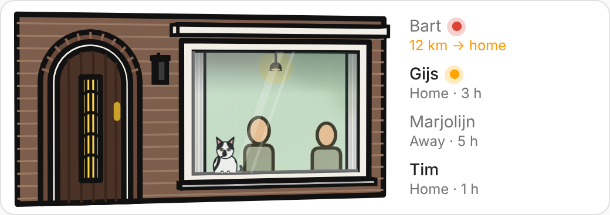

# Streetview House

Who is home, at a glance: the street side of the house as a line drawing, with the family standing behind the front window. The counterpart of [Gardenview House](https://github.com/BarBaar44/gardenview-house), which draws the garden side.



* **Whoever is home stands in the window**, each in their own spot (the order of the `people` list). Away: the spot is empty.
* **Room light and door light** are on while anyone is home, or follow real lights when you set `room_light` and `door_light`.
* **Coming home:** with a proximity sensor, the row reads "12 km → home" and, while the house is still empty, the door light pulses.
* **The cat** comes and goes: with nobody home it is on the sill more often than not; with people home it drops by now and then.
* **One row per person:** name, presence and since when ("Home · 3 h", "Away · 5 h", a zone name), a red badge when the phone battery is low and not charging, a bolt while charging.
* **Tap** a row or a person in the window: more-info of that person (map and history). Hold: optional.

Read only: the card calls no services. One file, no dependencies, no card_mod.

## Install

**Home Assistant 2026.11 and newer (Marketplace):** Settings → Marketplace → ⋮ → Add from link → `https://github.com/BarBaar44/streetview-house`, category Dashboard. Install, then reload the browser.

**Older versions (HACS):** HACS → ⋮ → Custom repositories → add the URL above as *Dashboard*, install, reload.

Manual: copy `streetview-house.js` to `/config/www/` and add `/local/streetview-house.js` as a JavaScript module resource.

## Portraits

Each person can have a portrait: a head and shoulders picture with a transparent background (PNG or WebP), facing the camera. Put them in `/config/www/streetview-house/` and point `portrait` at `/local/streetview-house/<name>.webp`. About 360 px wide is plenty (around 40 KB as WebP).

Without a portrait file, or when it cannot be loaded, the card uses the person's picture from Home Assistant; without either, a plain figure. Portraits stay on your own Home Assistant, never in this repository.

## Configuration

```yaml
type: custom:streetview-house
grid_options:
  columns: 12
  rows: 3
```

Everything else is optional, in YAML or in the visual editor. The defaults are the owner's household; set `people` for your own.

```yaml
type: custom:streetview-house
people:
  - entity: person.alex
    portrait: /local/streetview-house/alex.webp
    battery: sensor.alex_phone_battery_level
    charging: sensor.alex_phone_battery_state
    distance: sensor.home_alex_distance
    direction: sensor.home_alex_direction_of_travel
  - person.sam            # just the person
entities:
  room_light: light.front_room
  door_light: light.hall
```

| Option | Default | |
|---|---|---|
| `people` | the owner's four | list of up to 4 (the window has room for four); a plain entity id is enough |
| `entities.room_light` | none | light or switch of the room behind the window; none: on while anyone is home |
| `entities.door_light` | none | the hall light behind the door grille; none: on while anyone is home |
| `battery_low` | `20` | % below which a phone that is not charging gets the red badge |
| `cat` | `true` | `false`: no cat |
| `tap_action` | more-info | for the person tapped (row or window) |
| `hold_action` | none | |
| `colors` | | `coming` (coming home text), `low` (battery badge), `charge` (charging badge) |

### Per person

| Key | | |
|---|---|---|
| `entity` | required | `person.*` |
| `name` | first word of the friendly name | |
| `portrait` | none | image URL, see Portraits; `null`: none |
| `height` | `0.95` | 0.5 to 1.2: relative height in the window |
| `battery` | none | battery level sensor (%) |
| `charging` | none | battery state sensor (`charging` / `discharging` / `full`), or any on/off entity |
| `distance` | none | proximity distance sensor |
| `direction` | none | proximity direction of travel (`towards` means coming home) |

A known entity (one of the owner's) keeps its defaults for the keys you leave out; `null` switches a role off.

### What the row says

| State | Row |
|---|---|
| `home` | Home · 40 min |
| `not_home` | Away · 5 h |
| a zone | Work · 2 h |
| away, direction `towards`, distance above 0 | 12 km → home (accent colour) |
| `unknown` / `unavailable` (no tracker) | name only, not greyed, not in the window |

## Layout

12 columns by 3 rows (184 px). On a narrow section (below 440 px) the picture drops the door and keeps the lantern and window, so the names keep their room. All animations (cat, door light, the reflection sliding over the glass) stop under reduced motion.

## License

MIT
